## Falcon HR

HR add-on for **Falcon Resource Management** on Frappe HR (HRMS) v16: document-expiry
tracking for employees *and* branches (companies/sponsors), an HR dashboard, downloadable
reports and notification-centre alerts. It only **adds** pages, reports, fields and
alerts; it does not modify any HRMS/ERPNext doctype or code.

### Screenshots

> Employee names and document numbers are masked in these images.

**HR Dashboard — overview** (search, filters, headline tiles, employee-status switch, headcount by branch, document health)

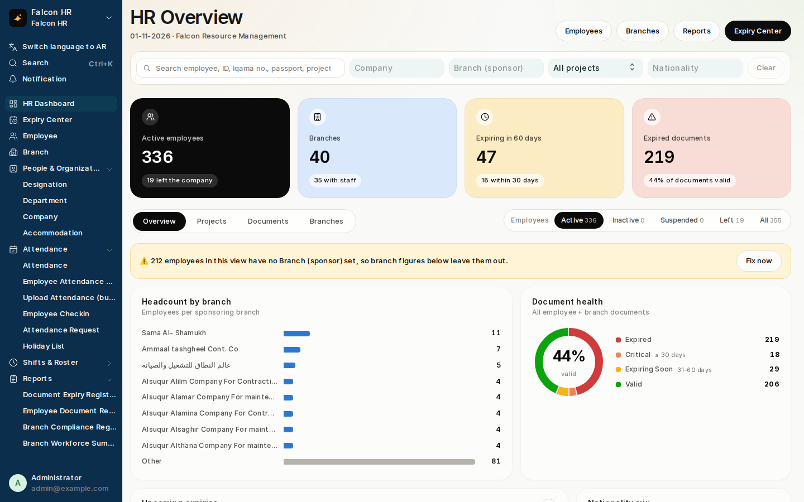

**Upcoming expiries, nationality mix, joiners & leavers** — every tile, bar and segment is clickable

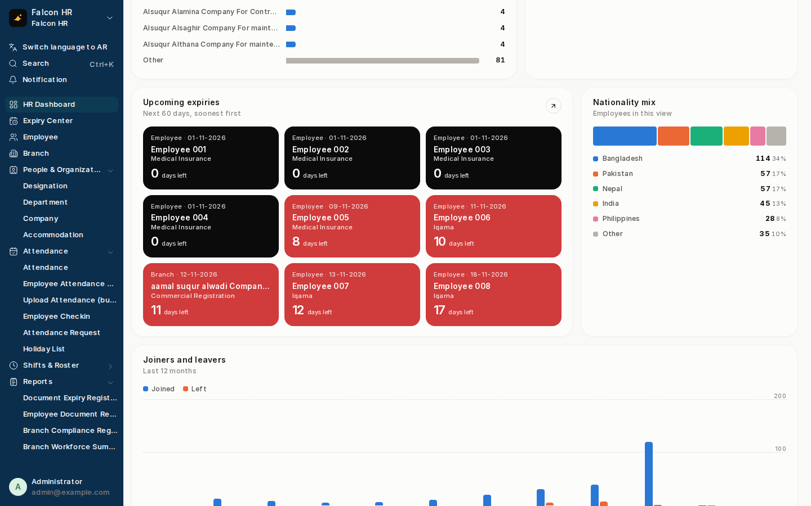

| Projects tab | Documents tab |
|---|---|
| 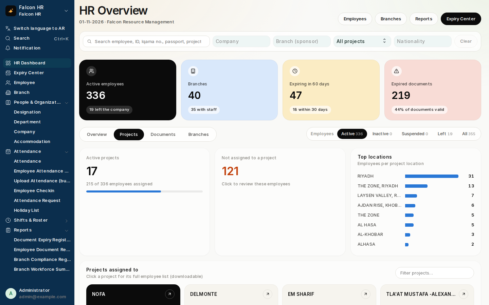 | 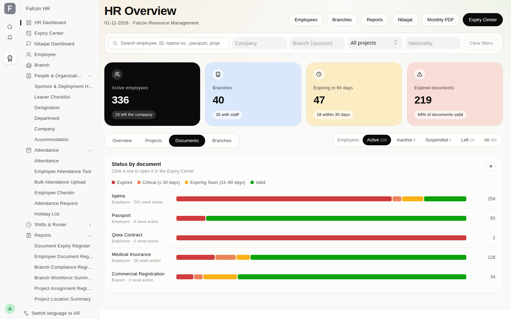 |
| **Branches tab** | **Filtered to one project (NOFA)** |
| 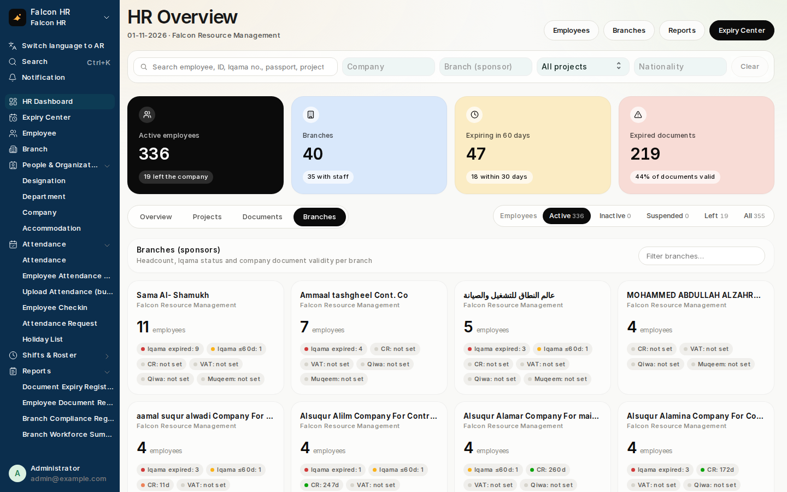 | 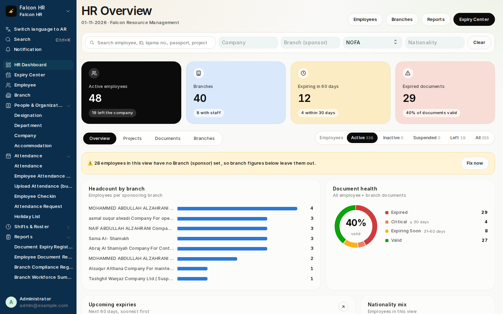 |

**Expiry Center — table** (status tiles, employee status, document chips, 9 filters, search)

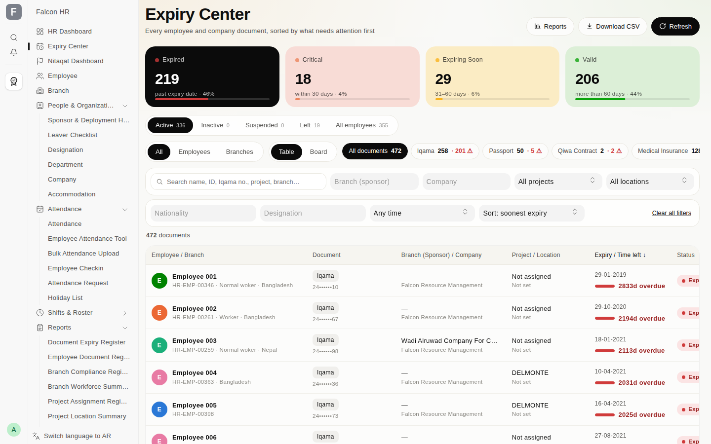

| Expiry Center — board | Branch Workforce Summary report |
|---|---|
| 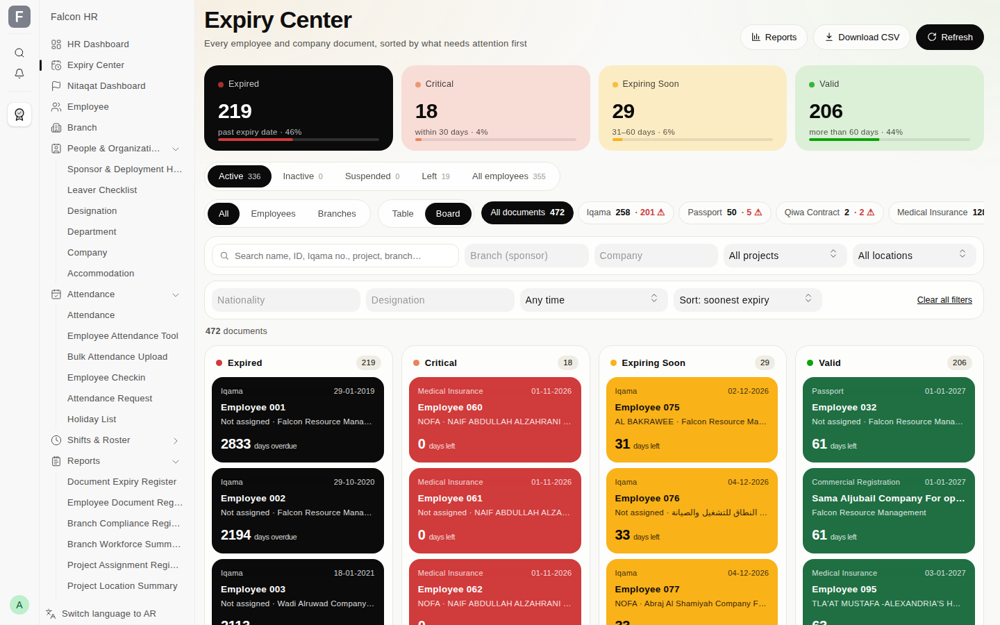 | 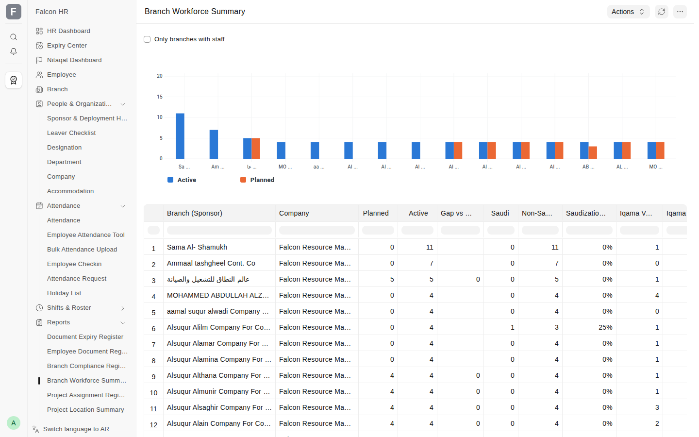 |

**Nitaqat dashboard** — Saudization vs target, Saudis needed, in-page reading guide, filters

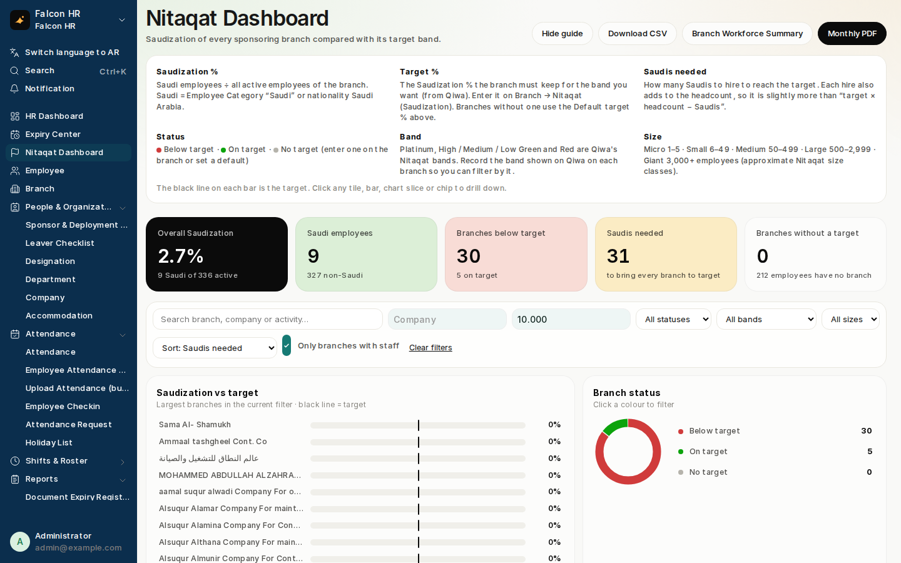

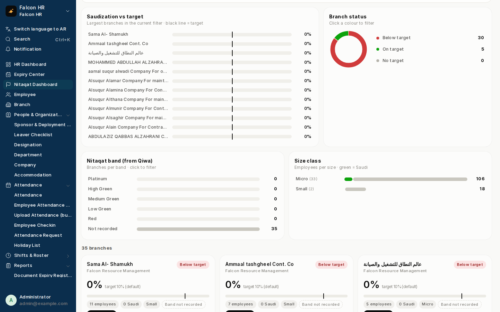

**Desktop icon**

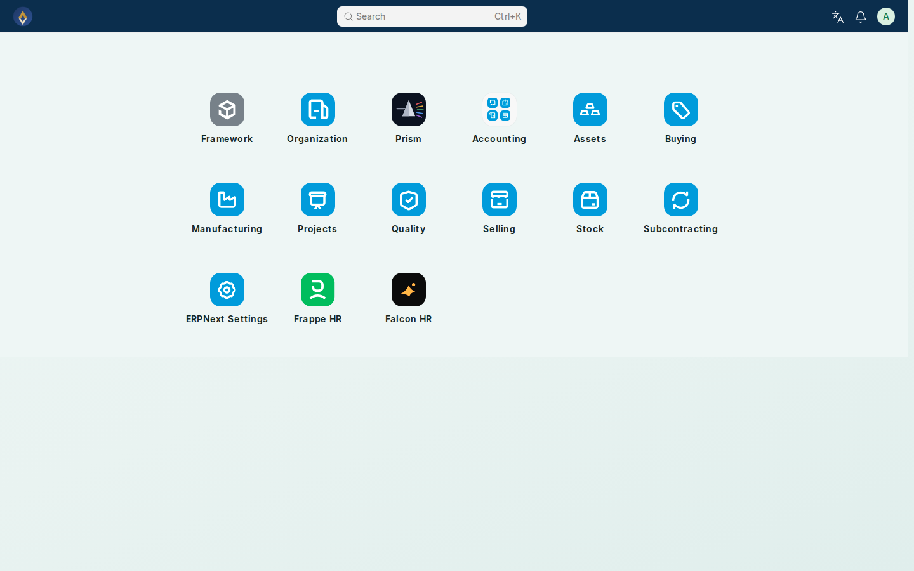

### What's inside

| Area | Where |
|---|---|
| HR Dashboard (Overview / Projects / Documents / Branches, employee-status switch) | `/app/falcon-hr-dashboard` |
| Expiry Center (all employee + company documents, 9 filters, search, table/board, CSV) | `/app/expiry-center` |
| Days-remaining under every expiry date | Employee and Branch forms |
| Branch overview (headcount + Iqama status) | top of every Branch form |
| Qiwa & Muqeem numbers/dates | Branch form, "Qiwa & Muqeem" section |
| Company-document alerts (60/15-day system, 30-day email) | Notifications named `Company Doc - …` |
| Daily bell alerts (60/30/15/7/3/1/0 days, day after, every 30 days overdue) | `falcon_hr.api.alerts.send_daily_alerts` |
| Reports: Document Expiry Register, Employee Document Register, Branch Compliance Register, Branch Workforce Summary, Project Assignment Register, Project Location Summary | sidebar → Reports |
| Nitaqat dashboard (Saudization vs target per branch, Saudis needed, band/size charts, filters, CSV) | `/app/nitaqat-dashboard` |
| Sponsor & deployment history (one current sponsor per employee, durations, syncs Employee branch/project) | Employee form; `Employee Deployment` |
| Leaver checklist (13 Saudi-specific steps on HRMS Employee Separation, auto-drafted when an employee is set to Left) | Employee (Left) → Leaver Checklist |
| Monthly management PDF | HR / Nitaqat dashboard → Monthly PDF |
| Arabic translations (358 strings; never overrides other apps' Arabic) | `falcon_hr/locale/ar.po` |
| Desktop icon + grouped sidebar | "Falcon HR" |

### Requirements

- Frappe v16, ERPNext v16, HRMS v16 (declared in `pyproject.toml` and `required_apps`).
- The Employee/Branch custom fields used by Falcon (Iqama, Visa, Qiwa contract, GOSI,
  CR, VAT, project assigned to, …) live in the site database. If a site lacks some of
  them, every page and report still loads — those columns are simply empty.

### Install on Frappe Cloud

1. Push this repo to GitHub (private is fine) and make sure the Frappe Cloud GitHub app
   can see it.
2. Frappe Cloud → your **Bench group** → **Apps** → **Add App** → *GitHub* → repo
   `Omarhabeeb27/falcon_hr`, branch `main`. (The Frappe Cloud GitHub app must have
   access to this private repo: GitHub → Settings → Applications → Frappe Cloud → Configure.)
3. **Deploy** the bench group so the app is built into it.
4. Site → **Apps** → **Install App** → *Falcon HR*. Installing runs `migrate`, which loads
   the fixtures (Branch Qiwa/Muqeem fields, Company Doc notifications), pages, reports,
   desktop icon and sidebar.
5. Hard-refresh the browser. The **Falcon HR** icon appears on the desktop.

Updates: push to the branch → Frappe Cloud shows an update → deploy → update the site.

### After installing — one-time setup on the site

1. **Holiday List Assignment** (HR Setup): Applicable For *Company* → *Falcon Resource
   Management* → Holiday List *2026* → from *01-01-2026* → Submit. HRMS v16 needs this
   for attendance, leave and the *Upload Attendance* bulk template.
2. **Email Account** (outgoing) if you want the email alerts; bell alerts work without it.
3. Make sure HR staff have the **HR Manager** or **HR User** role — that's who gets alerts.

### Verified

- Clean install on a fresh frappe + erpnext + hrms site.
- Install on a copy of the production database (restored Frappe Cloud backup):
  all pages, reports, alerts and fixtures work; uninstall leaves the site's own
  Employee/Branch custom fields and alert rules untouched.

### Install locally

```bash
bench get-app <repo-url>
bench --site <site> install-app falcon_hr
bench restart   # or restart `bench start`: sidebars are cached by the web workers
```

### Data the app creates on install

- `Employee Deployment` rows seeded from each employee's current Branch (once; idempotent).
- Employee Separation Template **Falcon Leaver Checklist**.
- Branch custom fields: Qiwa & Muqeem, Nitaqat (activity, band, target %, last checked).

### Uninstalling

Uninstall removes only what this app created (its pages, reports, sidebar, icon, the
Qiwa/Muqeem Branch fields and the Company Doc notifications). Falcon's other existing
Employee/Branch custom fields are not owned by this app and are left untouched.

### License

MIT
